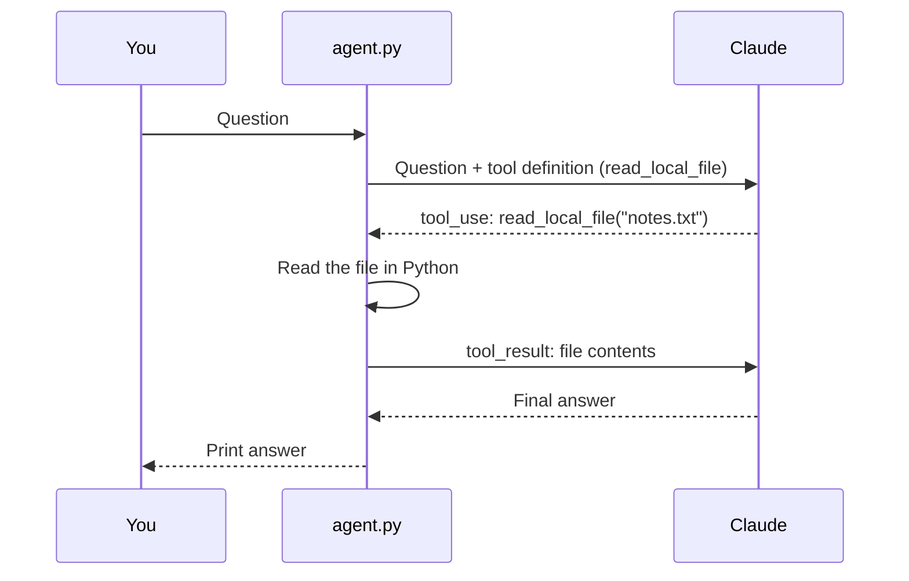

# tool-use-agent

A minimal **Claude tool-use agent** in Python. You ask a question, Claude decides
it needs to read a local file, calls a Python tool to read it, and answers using
the file's contents. Built to learn the core loop behind every AI agent.

## How it works


**Key idea:** Claude never touches your files directly. It *asks* for a tool
with arguments, your code runs it, and you send the result back. That
request → execute → return loop is the foundation of agentic AI.

## Run it
```bash
python3 -m venv .venv && source .venv/bin/activate
pip install anthropic python-dotenv
echo "ANTHROPIC_API_KEY=your-key-here" > .env
python3 agent.py
```
Then ask: *When is the project deadline? Check notes.txt.*
Claude calls `read_local_file("notes.txt")` and answers: **March 15th**.

## What I learned
- How to define a tool with a JSON schema so Claude knows when and how to call it
- How to read `tool_use` blocks and return results to Claude
- Keeping API keys out of code with `.env` and `python-dotenv`
